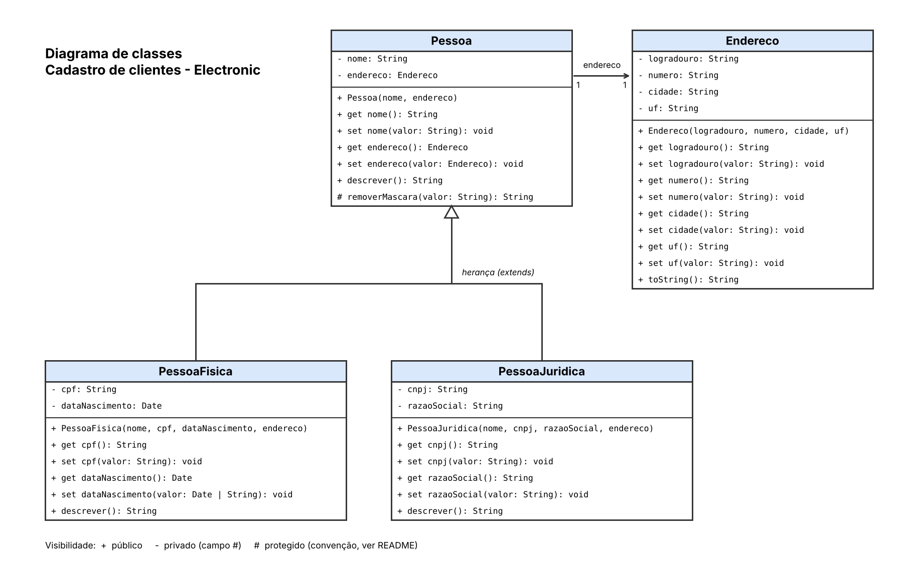

# Cadastro de Clientes da Electronic

Atividade 01 — Cadastro de Clientes da Electronic: da Modelagem ao Código
(Programação Orientada a Objetos)

## Identificação do estudante

| Campo | Informação |
|---|---|
| Nome | Daniel da Silva Marques do Nascimento |
| Curso / Unidade Curricular | program_orientada_obj_desfll_t01rn |

## Sobre o projeto

Módulo de cadastro de clientes de um aplicativo de e-commerce de produtos
eletrônicos. Armazena **pessoas físicas** e **pessoas jurídicas**, reaproveita
código por **herança**, protege os dados por **encapsulamento** (campos privados
`#`, getters e setters) e impede o cadastro de valores inválidos com
`throw`, `try` e `catch`. Ao final da execução, exibe somente os cadastros válidos.

## Estrutura do repositório

```
.
├── diagrama/
│   ├── diagrama-classes.drawio   # diagrama editável (Draw.io / app.diagrams.net)
│   ├── diagrama-classes.png      # imagem do diagrama
│   └── diagrama-classes.pdf      # diagrama em PDF
├── src/
│   ├── Endereco.js
│   ├── Pessoa.js                 # classe base
│   ├── PessoaFisica.js           # extends Pessoa
│   └── PessoaJuridica.js         # extends Pessoa
├── index.js                      # programa principal (cenários de teste)
├── testes.js                     # testes automatizados (node:assert)
├── package.json
└── README.md
```

## Como executar

Requisitos: [Node.js](https://nodejs.org) 18 ou superior (usa campos privados e módulos ES).
Não há dependências para instalar.

```bash
git clone <URL-DO-REPOSITORIO>
cd cadastro-clientes-electronic
node index.js      # executa os cenários e mostra os cadastros válidos
node testes.js     # (opcional) executa os testes automatizados
```

## Diagrama de classes (UML)



Arquivos: [`diagrama-classes.drawio`](diagrama/diagrama-classes.drawio) e
[`diagrama-classes.pdf`](diagrama/diagrama-classes.pdf).

**Relações:** `PessoaFisica` e `PessoaJuridica` herdam de `Pessoa`
(`extends`/`super`); `Pessoa` possui um `Endereco`.

**Visibilidade:** `+` público, `-` privado e `#` protegido. Os campos privados do
diagrama são campos `#` do JavaScript. O JavaScript não tem modificador
*protected*, então o método `# removerMascara` de `Pessoa` é um método comum de
instância, marcado com `@protected` no código e usado apenas pelas classes derivadas.

## Regras de validação implementadas

| Regra | Onde | Erro lançado |
|---|---|---|
| Nome com ao menos 3 caracteres | `Pessoa.nome` (setter) | `Nome inválido: deve ter ao menos 3 caracteres.` |
| CPF com 11 dígitos (ignora `.` `-` `/` e espaços) | `PessoaFisica.cpf` | `CPF inválido: deve ter 11 dígitos.` |
| CNPJ com 14 dígitos (ignora `.` `-` `/` e espaços) | `PessoaJuridica.cnpj` | `CNPJ inválido: deve ter 14 dígitos.` |
| Data de nascimento válida (`DD/MM/AAAA` ou `AAAA-MM-DD`) | `PessoaFisica.dataNascimento` | `Data de nascimento inválida: informe uma data existente.` |
| Data de nascimento não pode estar no futuro | `PessoaFisica.dataNascimento` | `Data de nascimento inválida: não pode estar no futuro.` |
| Razão social obrigatória | `PessoaJuridica.razaoSocial` | `Razão social inválida: campo obrigatório.` |
| Endereço deve ser um objeto `Endereco` | `Pessoa.endereco` | `Endereço inválido: informe um objeto do tipo Endereco.` |

O construtor chama os setters, então a validação vale tanto na criação quanto em
alterações posteriores. Em `index.js`, a função `cadastrar` captura o erro com
`try`/`catch`, informa o motivo e segue para o próximo cadastro, sem derrubar o programa.

## Evidências de teste

Saída do terminal ao executar `node index.js`.

### Cenário 1 — Pessoa física válida

```
Cenário 1 - Pessoa física válida
  [OK]   Maria Silva (CPF com máscara, data DD/MM/AAAA)
```

### Cenário 2 — Pessoa jurídica válida

```
Cenário 2 - Pessoa jurídica válida
  [OK]   Electronic Store (CNPJ com máscara)
```

### Cenário 3 — Pessoa física inválida

```
Cenário 3 - Pessoa física inválida (CPF com 10 dígitos)
  [ERRO] Carlos Souza
         Motivo: CPF inválido: deve ter 11 dígitos.
```

### Cenário 4 — Pessoa jurídica inválida

```
Cenário 4 - Pessoa jurídica inválida (razão social vazia)
  [ERRO] Tech Atacado
         Motivo: Razão social inválida: campo obrigatório.
```

### Cenários extras

```
Cenários extras de validação
  [ERRO] Pessoa física com nome de 2 caracteres
         Motivo: Nome inválido: deve ter ao menos 3 caracteres.
  [ERRO] Pessoa física com data de nascimento no futuro
         Motivo: Data de nascimento inválida: não pode estar no futuro.
  [ERRO] Pessoa física com data inexistente (31/02/2000)
         Motivo: Data de nascimento inválida: informe uma data existente.
  [ERRO] Pessoa jurídica com CNPJ de 13 dígitos
         Motivo: CNPJ inválido: deve ter 14 dígitos.
  [OK]   Pessoa física válida (CPF sem máscara, data AAAA-MM-DD)
```

### Resultado final: somente cadastros válidos

```
=== Cadastros válidos ===
1. [Pessoa Física] Nome: Maria Silva | Endereço: Rua das Flores, 120 - Niterói/RJ | CPF: 123.456.789-09 | Nascimento: 15/03/1990
2. [Pessoa Jurídica] Nome: Electronic Store | Endereço: Av. Rio Branco, 156 - Rio de Janeiro/RJ | CNPJ: 12.345.678/0001-95 | Razão social: Electronic Comércio de Eletrônicos Ltda
3. [Pessoa Física] Nome: João Pereira | Endereço: Rua das Flores, 120 - Niterói/RJ | CPF: 987.654.321-00 | Nascimento: 30/11/1978

Total de cadastros válidos: 3
```

### Testes automatizados (`node testes.js`)

```
Testes automatizados

  ok  - herança: PessoaFisica e PessoaJuridica são Pessoa
  ok  - nome com menos de 3 caracteres lança erro
  ok  - CPF aceita pontos e traço e guarda só 11 dígitos
  ok  - CPF com quantidade errada de dígitos lança erro
  ok  - CPF com letras lança erro
  ok  - CNPJ aceita ponto, barra e traço e guarda só 14 dígitos
  ok  - CNPJ com 13 dígitos lança erro
  ok  - razão social vazia lança erro
  ok  - data de nascimento no futuro lança erro
  ok  - data inexistente (31/02/2000) lança erro
  ok  - data de nascimento aceita DD/MM/AAAA e AAAA-MM-DD
  ok  - setters também validam depois da criação
  ok  - endereço precisa ser um objeto Endereco
  ok  - campos privados não são acessíveis de fora
  ok  - polimorfismo: descrever() é específico de cada classe

15 aprovados, 0 falhas
```

## Histórico de commits

O histórico do repositório mostra a evolução do trabalho

O histórico do repositório mostra a evolução do trabalho, do diagrama à documentação.
Saída de `git log --oneline --reverse`:

```
eac5d53 Adiciona diagrama de classes UML
557c3cd Cria classe Endereco
11cbf0f Cria classe base Pessoa com validação de nome
b355e5c Cria PessoaFisica (CPF e data de nascimento)
cd6c429 Cria PessoaJuridica (CNPJ e razão social)
73e9a9d Adiciona programa principal com cenários
2852d4a Adiciona testes automatizados
7aa58b6 Adiciona README com evidências de teste

```
